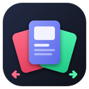
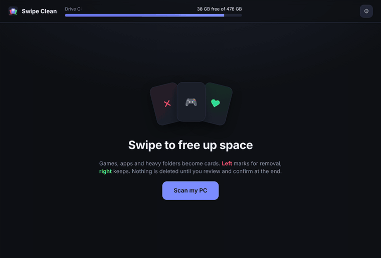
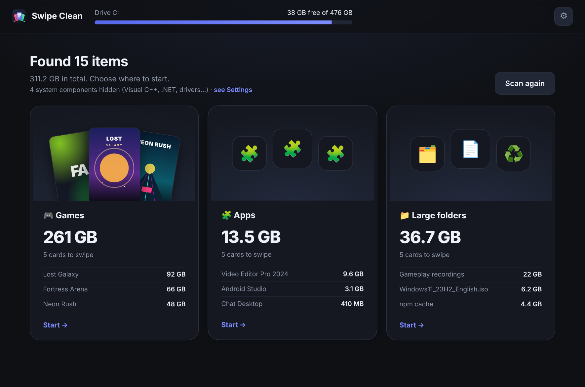

<div align="center">



# Swipe Clean

**Free up space on your PC by swiping cards.**
Games, apps and heavy folders show up one at a time: swipe left to remove, right to keep.

[](https://github.com/xdropp/swipe-clean/releases/latest)

[](https://github.com/xdropp/swipe-clean/releases/latest)
[](https://github.com/xdropp/swipe-clean/releases)

[](LICENSE.txt)

**English** · [Português](README.pt-BR.md)



</div>

## Why Swipe Clean

Cleanup tools usually throw a huge, scary list at you. Swipe Clean does the opposite: it shows **one item at a time, biggest first**, with everything you need to decide. How much space it takes, when you last used it, and what happens if you remove it.

- 🎮 **Games** from Steam, Epic Games and other stores, with cover art and last-played date.
- 🧩 **Apps** you installed, including Microsoft Store apps.
- 📁 **Large folders**: forgotten downloads, caches, temporary files and leftovers from programs you already uninstalled.



## Safe by default

- **Swiping only marks.** Nothing is deleted until you review the list and confirm.
- **Personal files go to the Recycle Bin**, so you can restore them.
- **Programs and games use their official uninstaller**, or Steam and Epic themselves.
- **System components stay out of the way.** Visual C++, .NET, DirectX, drivers and other libraries that games and programs need never become cards.
- **No account, no ads, no telemetry.** Your list of programs never leaves your PC. See the [privacy policy](PRIVACY.md).
- **Updates itself safely.** The installed version downloads new releases from this page and checks their SHA-256 before installing.


## Install

1. Go to [**Releases**](https://github.com/xdropp/swipe-clean/releases/latest) and download one of the files:
   - **`SwipeClean-Setup-x.y.z.exe`** installs with Start menu shortcuts (recommended).
   - **`SwipeClean-Portable-x.y.z.exe`** runs directly, no installation.
2. Open the downloaded file. Nothing else to install.

When a new version comes out, the app lets you know. The installed version updates with one click; the portable one takes you to the download. You can turn the check off in **⚙ Settings**.

The app follows your Windows language (English or Portuguese). You can change it in **⚙ Settings → Language**.

> **"Windows protected your PC"?** This warning shows up for new programs that don't have a digital signature yet. Click **More info → Run anyway**. Swipe Clean is open source, so you can check everything it does right here in this repository.

## FAQ

<details>
<summary><b>Does it delete things on its own?</b></summary>

No. Swiping left only adds an item to a queue. At the end you see the full list, can uncheck anything and must confirm. Even then, personal files go to the Recycle Bin.
</details>

<details>
<summary><b>Why do some apps say "Run as admin" for last used?</b></summary>

Windows only reveals when each program was last opened to apps with administrator rights. Use **⚙ Settings → Restart as admin**. Steam games show the last-played date either way.
</details>

<details>
<summary><b>Where do the game covers come from?</b></summary>

First from the images Steam already keeps on your PC. When there are none, the game's name is searched in the Steam or Epic store. You can turn this off in **⚙ Settings**.
</details>

<details>
<summary><b>Where are Visual C++, .NET and my drivers?</b></summary>

They're hidden on purpose: games and programs depend on them, and removing them frees almost no space. If you really need to, turn on **⚙ Settings → Show system components**.
</details>

<details>
<summary><b>I removed something by mistake. Now what?</b></summary>

Files and folders are in the **Recycle Bin**, just restore them from there. Programs and games can be reinstalled from their store or website; your games stay in your Steam or Epic library.
</details>

<details>
<summary><b>How do I know the download is genuine?</b></summary>

Every release is built by GitHub Actions straight from the code in this repository, and comes with a `SHA256SUMS.txt` file. To check a download, run this in PowerShell and compare the result with the file:

```powershell
Get-FileHash .\SwipeClean-Setup-x.y.z.exe -Algorithm SHA256
```

The automatic updater does the same check before installing anything.
</details>

<details>
<summary><b>Does it work on Mac or Linux?</b></summary>

Not yet, only Windows 10 and 11.
</details>

## Problems and ideas

Found a bug or have an idea? [Open an issue](https://github.com/xdropp/swipe-clean/issues/new/choose). For bugs, please attach `log.txt` (**⚙ Settings → Open folder**). It really helps figure out what happened.

What's new in each version is in the [CHANGELOG](CHANGELOG.md). Want to help? See [CONTRIBUTING](CONTRIBUTING.md) and the [development guide](docs/DEVELOPMENT.md). To report a security issue privately, see [SECURITY](SECURITY.md).

## License

[MIT](LICENSE.txt) © 2026 Gabriel Froes
