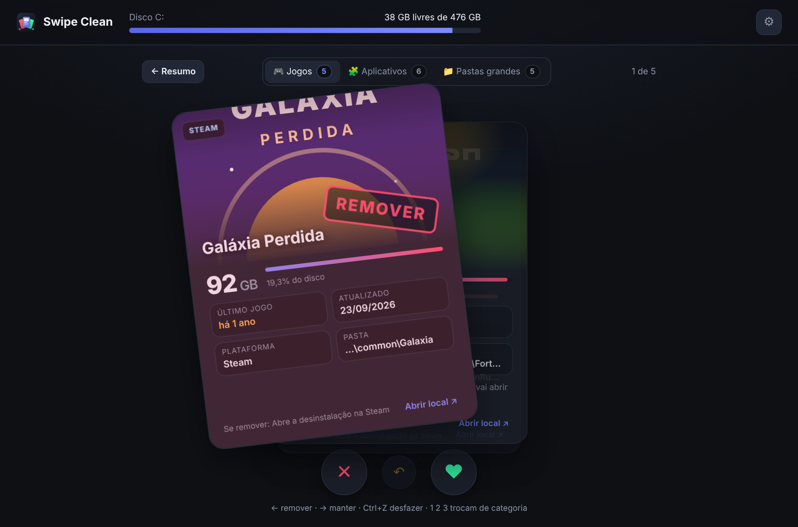
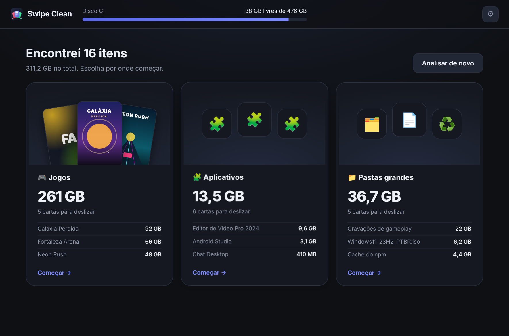
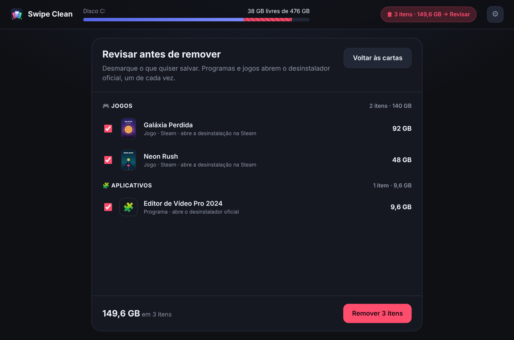

# Swipe Clean

**Libere espaço no seu PC deslizando cartas.**
Jogos, aplicativos e pastas pesadas aparecem um de cada vez: deslize para a esquerda para remover, para a direita para manter.

## Por que usar

Ferramentas de limpeza costumam mostrar uma lista enorme e assustadora. O Swipe Clean faz o contrário: mostra **um item por vez, do maior para o menor**, com tudo o que você precisa para decidir. Tamanho, quando você usou pela última vez e o que acontece se remover.

- 🎮 **Jogos** da Steam, da Epic Games e de outras lojas, com capa e data do último jogo.
- 🧩 **Aplicativos** instalados e apps da Microsoft Store.
- 📁 **Pastas grandes:** downloads esquecidos, caches, arquivos temporários e dados de programas que você já desinstalou.

## Seguro por padrão

- **Deslizar só marca.** Nada é apagado antes de você revisar a lista e confirmar.
- **Arquivos pessoais vão para a Lixeira**, então dá para recuperar.
- **Programas e jogos saem pelo desinstalador oficial** deles, ou pela própria Steam ou Epic.
- **Componentes do sistema ficam de fora.** Visual C++, .NET, DirectX, drivers e outras bibliotecas que jogos e programas precisam não viram cartas.
- **Nada sai do seu PC.** Sem conta, sem anúncios, sem telemetria. Veja a [política de privacidade](PRIVACIDADE.md).

## Como instalar

1. Vá em [**Releases**](https://github.com/xdropp/swipe-clean/releases/latest) e baixe um dos arquivos:
   - **`SwipeClean-Setup-x.y.z.exe`** instala com atalhos no menu Iniciar (recomendado).
   - **`SwipeClean-Portatil-x.y.z.exe`** abre direto, sem instalar.
2. Abra o arquivo baixado. Não precisa instalar mais nada.

> **"O Windows protegeu o computador"?** Esse aviso aparece para programas novos que ainda não têm assinatura digital. Clique em **Mais informações → Executar assim mesmo**. O código do Swipe Clean é aberto e você pode conferir tudo o que ele faz aqui no repositório.

## Perguntas frequentes

<b>Ele apaga coisas sozinho?</b>

Não. Deslizar para a esquerda só coloca o item numa fila. No final você vê a lista completa, pode desmarcar o que quiser e precisa confirmar. Mesmo depois disso, arquivos pessoais vão para a Lixeira.

<b>Por que alguns aplicativos mostram "Abra como admin" no último uso?</b>

O Windows só deixa ver quando cada programa foi aberto com permissão de administrador. Use **⚙ Configurações → Reiniciar como administrador**. Jogos da Steam mostram a data do último jogo mesmo sem isso.

<b>De onde vêm as capas dos jogos?</b>

Primeiro das imagens que a Steam já guarda no seu PC. Quando não há, o nome do jogo é pesquisado na loja da Steam ou da Epic. Dá para desligar isso em **⚙ Configurações**.

<b>Removi algo por engano. E agora?</b>

Arquivos e pastas estão na **Lixeira**: é só restaurar de lá. Programas e jogos podem ser instalados de novo pela loja ou pelo site de origem; seus jogos continuam na sua biblioteca da Steam ou da Epic.

<b>Funciona em Mac ou Linux?</b>

Por enquanto, só Windows 10 e 11.

## Problemas e sugestões

Encontrou um erro ou tem uma ideia? [Abra uma issue](https://github.com/xdropp/swipe-clean/issues/new/choose). Para erros, anexe o `log.txt` (**⚙ Configurações → Abrir pasta**). Ele ajuda muito a descobrir o que aconteceu.

As novidades de cada versão estão no [CHANGELOG](CHANGELOG.md). Para rodar o código ou contribuir, veja o [guia de desenvolvimento](docs/DESENVOLVIMENTO.md).

## Licença

[MIT](LICENSE.txt) © 2026 Gabriel Froes
